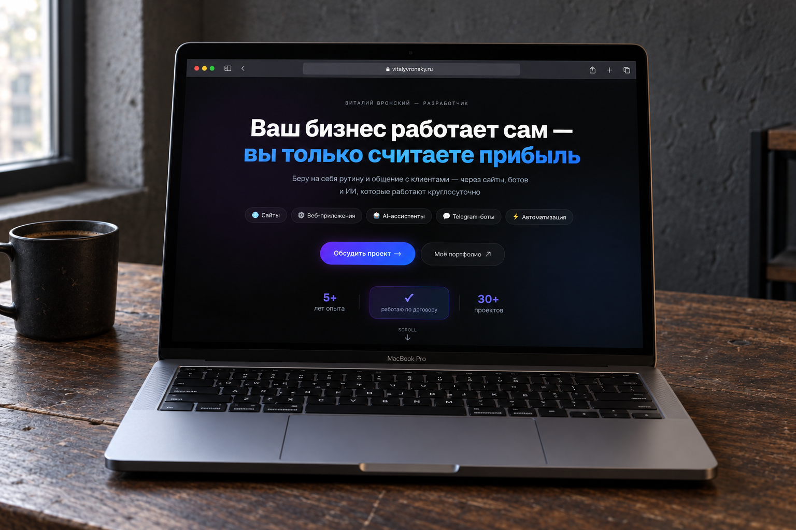
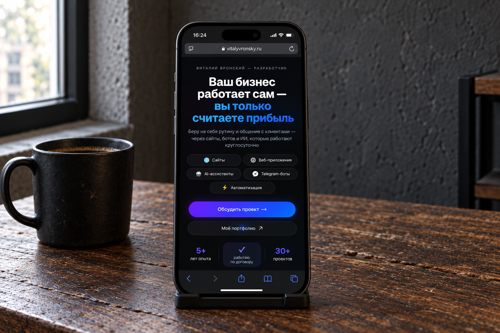

# next-portfolio-advertising

Лендинг для продвижения услуг по **автоматизации бизнеса**, **созданию сайтов и веб-приложений** и **внедрению ИИ в организации**. Подготовлен под запуск рекламы в Яндекс.Директ.

- Сайт проекта: [vitalyvronsky.ru](https://vitalyvronsky.ru)
- Сайт-портфолио автора: [vronskyvitaly.ru](https://vronskyvitaly.ru)

<table>
  <tr>
    <td width="60%"></td>
    <td width="40%"></td>
  </tr>
  <tr>
    <td align="center">Десктоп</td>
    <td align="center">Мобильная версия</td>
  </tr>
</table>

---

## Стек

| Слой | Технология |
|------|-----------|
| Фреймворк | Next.js 16 (App Router, Turbopack) |
| UI | React 19 + React Compiler |
| Стили | Tailwind CSS v4 |
| Язык | TypeScript (strict) |
| Шрифт | Geist Sans / Geist Mono |

---

## Структура проекта

```
src/
├── app/
│   ├── layout.tsx       # Корневой layout, метатеги, шрифты
│   ├── page.tsx         # Главная страница — сборка секций
│   └── globals.css      # Tailwind v4, CSS-переменные, keyframe-анимации
└── components/
    ├── Hero.tsx          # Первый экран: заголовок, CTA, статистика
    ├── Services.tsx      # Три направления услуг
    ├── Benefits.tsx      # Преимущества работы
    ├── Process.tsx       # Этапы сотрудничества
    ├── Faq.tsx           # Часто задаваемые вопросы (аккордеон)
    ├── Contact.tsx       # Блок контактов и CTA
    └── Footer.tsx        # Подвал
```

---

## Запуск

```bash
npm install
npm run dev       # http://localhost:3000
```

```bash
npm run build     # production-сборка
npm run start     # запуск production-сервера
npm run lint      # ESLint
```

---

## Производительность


Lighthouse, главная страница [vitalyvronsky.ru](https://vitalyvronsky.ru), мобильная эмуляция, режим инкогнито (28.10.2026):

| Метрика | Значение |
|---------|----------|
| First Contentful Paint | 1.2 s |
| Largest Contentful Paint | 1.7 s |
| Total Blocking Time | 10 ms |
| Cumulative Layout Shift | 0.024 |

Что для этого сделано:

- cookie-баннер рендерится на сервере, а не после гидратации — он не становится поздним LCP
- CSS встроен в HTML (`experimental.inlineCss`) — нет блокирующего запроса стилей
- `preconnect` к Яндекс.Метрике, скрипт Метрики грузится `afterInteractive`
- контраст текста не ниже 4.5:1

---

## Дизайн

- **Тёмная тема** — единственная, без переключателя
- **Акцентные цвета** — фиолетовый `#7d2cc8`, синий `#0070f3`, голубой `#00d4ff`
- **Анимации** — чистый CSS (`@keyframes`), без Framer Motion
- **Типографика** — Geist Sans (кириллический subset подключён)
- **Фото** — не добавлены, зарезервированы для последующего добавления

---

## Контакты автора

- Telegram: [@vitalyvronsky](https://t.me/vitalyvronsky)
- Email: vronskyvitaly@mail.ru
- Портфолио: [vronskyvitaly.ru](https://vronskyvitaly.ru)
