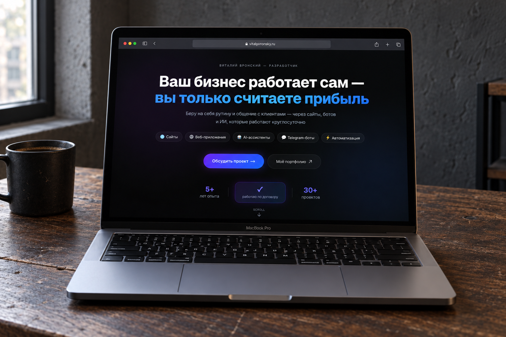
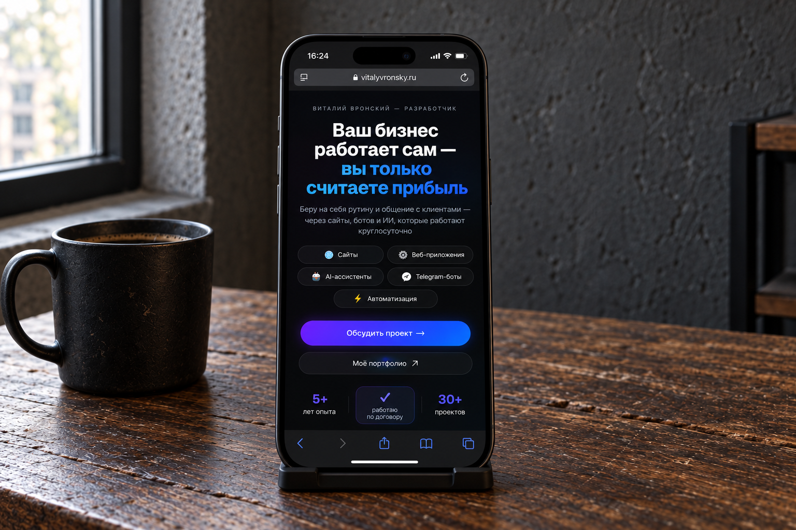
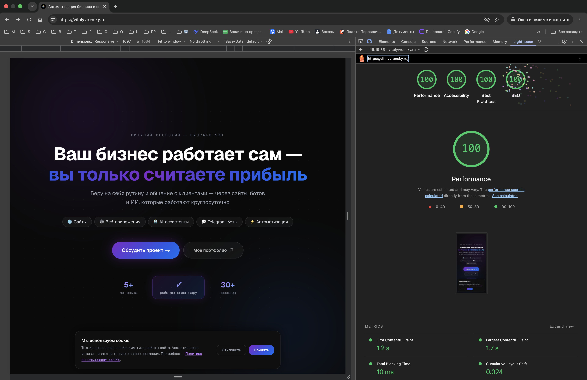

# next-portfolio-advertising

Лендинг для продвижения услуг по **автоматизации бизнеса**, **созданию сайтов и веб-приложений** и **внедрению ИИ в организации**. Подготовлен под запуск рекламы в Яндекс.Директ.

- Сайт проекта: [vitalyvronsky.ru](https://vitalyvronsky.ru)
- Сайт-портфолио автора: [vronskyvitaly.ru](https://vronskyvitaly.ru)

<table>
  <tr>
    <td width="60%"></td>
    <td width="40%"></td>
  </tr>
  <tr>
    <td align="center">Десктоп</td>
    <td align="center">Мобильная версия</td>
  </tr>
</table>

---

## Стек

| Слой | Технология |
|------|-----------|
| Фреймворк | Next.js 16 (App Router, Turbopack) |
| UI | React 19 + React Compiler |
| Стили | Tailwind CSS v4 |
| Язык | TypeScript (strict) |
| Шрифт | Geist Sans / Geist Mono |

---

## Структура проекта

```
src/
├── app/                     # Только маршрутизация: page.tsx/layout.tsx реэкспортируют
│   │                        # компонент страницы и её metadata
│   ├── layout.tsx           # Корневой layout: html/body, шрифты, Метрика, GA, cookie-баннер
│   ├── page.tsx             # / → components/pages/home
│   ├── blog/                # /blog и /blog/<slug>
│   ├── brief/               # /brief
│   ├── legal/               # /legal и /legal/[slug]
│   ├── sozdanie-saytov/     # /sozdanie-saytov и /sozdanie-saytov/[slug]
│   ├── api/                 # API-роуты
│   ├── sitemap.ts, robots.ts, opengraph-image.tsx
│   └── globals.css          # Tailwind v4, CSS-переменные, keyframe-анимации
├── components/              # Разметка
│   ├── pages/               # Страницы целиком: <маршрут>/index.tsx, metadata.ts,
│   │   │                    # constants.ts, ассеты (обложки .webp)
│   │   ├── home/
│   │   ├── blog/            # индекс блога и blog/<slug>/ для каждой статьи
│   │   ├── brief/
│   │   ├── legal/           # индекс, metadata.ts, document/ для [slug]
│   │   └── sozdanie-saytov/ # хаб и service/ для [slug] (+ NichePage)
│   ├── layout/              # Footer, metadata.ts корневого layout
│   ├── sections/
│   │   ├── home/            # Секции главной: Hero, Services, Benefits, Process, Blog, Faq, Contact
│   │   └── shared/          # Общие блоки страниц услуг: ContactCta, PriceMosaic
│   ├── ui/                  # Мелкие элементы: Breadcrumbs, BlogBreadcrumbs, FaqList
│   ├── forms/               # LeadForm
│   ├── seo/                 # JsonLd
│   └── legal/               # Cookie-баннер, Google Аналитика, правовые документы
├── common/
│   ├── data/
│   │   ├── pages/<маршрут>/ # Статические данные страниц (массивы, FAQ, JSON-LD) и их типы
│   │   └── sections/        # Данные секций: home/hero.ts, home/services.ts, shared/price-mosaic.ts…
│   └── helpers/             # Хелперы (отправка почты и др.)
└── config/                  # Реестры и конфиги
    ├── routes.ts            # Единый реестр внутренних путей сайта
    ├── posts.ts             # Реестр статей блога
    └── services.ts          # Услуги и цены
```

---

## Запуск

```bash
npm install
npm run dev       # http://localhost:3000
```

```bash
npm run build     # production-сборка
npm run start     # запуск production-сервера
npm run lint      # ESLint
```

---

## Производительность


Lighthouse, главная страница [vitalyvronsky.ru](https://vitalyvronsky.ru), мобильная эмуляция, режим инкогнито (28.10.2026):

| Метрика | Значение |
|---------|----------|
| First Contentful Paint | 1.2 s |
| Largest Contentful Paint | 1.7 s |
| Total Blocking Time | 10 ms |
| Cumulative Layout Shift | 0.024 |



Что для этого сделано:

- cookie-баннер рендерится на сервере, а не после гидратации — он не становится поздним LCP
- CSS встроен в HTML (`experimental.inlineCss`) — нет блокирующего запроса стилей
- `preconnect` к Яндекс.Метрике, скрипт Метрики грузится `afterInteractive`
- контраст текста не ниже 4.5:1

---

## Дизайн

- **Тёмная тема** — единственная, без переключателя
- **Акцентные цвета** — фиолетовый `#7d2cc8`, синий `#0070f3`, голубой `#00d4ff`
- **Анимации** — чистый CSS (`@keyframes`), без Framer Motion
- **Типографика** — Geist Sans (кириллический subset подключён)
- **Фото** — не добавлены, зарезервированы для последующего добавления

---

## Контакты автора

- Telegram: [@vitalyvronsky](https://t.me/vitalyvronsky)
- Email: vronskyvitaly@mail.ru
- Портфолио: [vronskyvitaly.ru](https://vronskyvitaly.ru)
